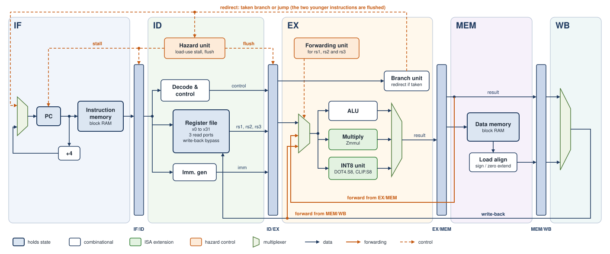
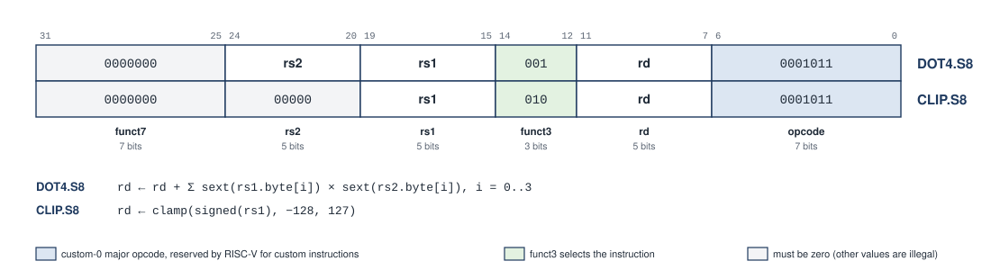

# RV32I core with INT8 instructions for keyword spotting

[](https://github.com/bilal-ahmad-khan-o7/rv32i-core/actions/workflows/tests.yml)
[](LICENSE)

A RISC-V core in SystemVerilog, built step by step from a single-cycle design to a 5-stage pipeline, that runs the MLPerf Tiny keyword-spotting (KWS) model on a PYNQ-Z2 FPGA. A solo project: design, verification, software and FPGA build are all my own work.

- **ISA:** RV32I + Zmmul (`mul`, `mulh`, `mulhsu`, `mulhu`) + two custom INT8 instructions, `DOT4.S8` and `CLIP.S8`.
- **Two cores:** single-cycle, and 5-stage pipelined with forwarding and a one-cycle load-use stall.
- **Verified:** both pass the official RISC-V architectural tests (RISCOF, compared with Spike), plus unit testbenches, directed hazard tests and random programs checked against an instruction simulator.
- **Bit-exact KWS:** every layer matches TFLite's reference kernels byte for byte. The custom instructions make the model 3.48× faster than with `mul` alone.



Detailed diagrams, with every signal: [single-cycle](single_cycle/docs/diagrams/diagrams.pdf), [pipelined](pipelined/docs/diagrams/diagrams.pdf).

## Results

| | Single-cycle | Pipelined |
|---|---:|---:|
| RISCOF: RV32I / multiply tests | 38/38, 4/4 | 38/38, 4/4 |
| Max clock on the PYNQ-Z2 (Vivado estimate) | 40.5 MHz | 59.3 MHz |
| KWS inference, build (c), cycles | 3.37 M | 3.56 M (CPI 1.056) |
| KWS inference, build (c), time | 83.2 ms | 60.0 ms |
| Slice LUTs / flip-flops / BRAM tiles / DSPs | 11,061 / 42 / 0 / 4 | 1,784 / 621 / 24 / 4 |

### What builds (a), (b) and (c) are

The KWS model is one C program, compiled three times. Each build lets the compiler use more of the core's instructions, so comparing them shows what each piece of hardware is worth.

| Build | Instructions the program may use | One multiply-accumulate is done by | KWS cycles (single-cycle core) |
|---|---|---|---:|
| **(a)** | RV32I only | a call to `__mulsi3`, the compiler's software multiply loop | 333 M |
| **(b)** | RV32I + Zmmul | `mul` + `add`: one multiply-accumulate per `mul` | 11.7 M |
| **(c)** | RV32I + Zmmul + `DOT4.S8`, `CLIP.S8` | `dot4.s8`: four multiply-accumulates in one instruction | 3.37 M |

All three produce the same output bytes. (b) → (c) is the 3.48× from the custom instructions. Build (c) is the one that runs on the FPGA. Accuracy on the 1000 test files is 90.1%, the same as TFLite.

## Custom instructions



Both use the custom-0 opcode (`0001011`), R format, funct7 = `0000000`.

| Instruction | funct3 | Operation |
|---|---|---|
| `DOT4.S8 rd, rs1, rs2` | `001` | `rd += Σ sext(rs1.byte[i]) · sext(rs2.byte[i])` over the 4 bytes |
| `CLIP.S8 rd, rs1` | `010` | `rd = clamp(signed(rs1), −128, 127)` |

## Repository layout

| Folder | Contents |
|---|---|
| [`single_cycle/`](single_cycle/) | the single-cycle core, its unit and whole-core testbenches |
| [`pipelined/`](pipelined/) | the 5-stage pipeline: reuses the single-cycle stage modules, adds pipeline registers, forwarding and hazard units |
| [`kws/`](kws/) | the keyword-spotting workload: bare-metal C, the Python/TFLite reference, generated images, results |
| [`iss/`](iss/) | `rv32iss`, the instruction-set simulator used as the golden model for both cores |
| [`riscof/`](riscof/) | the official RISC-V architectural tests: DUT and Spike plugins, testbench, run script |
| [`fpga/`](fpga/) | Vivado scripts and the PYNQ-Z2 wrapper for both cores |
| [`docs/`](docs/) | the overview diagrams (draw.io) |

Each folder's README covers its design, tests and results in detail.

## Quick start

Requires Icarus Verilog 12+ and Python 3 (Ubuntu / WSL2). RISCOF also needs `riscv64-unknown-elf-gcc` and Spike; see [`riscof/README.md`](riscof/README.md).

```bash
python3 single_cycle/sim/run_tests.py
```

```bash
python3 pipelined/sim/run_tests.py
```

```bash
cd riscof && ./run_riscof.sh
```

The first two run the fast regression suites: 13 and 18 testbenches, a few seconds each, also run by GitHub Actions on every push. The third runs the 38 RV32I architectural tests.

## Tools

Icarus Verilog, GTKWave, RISC-V GCC, Spike, RISCOF, Vivado, Python (NumPy, TFLite).

## Licence

MIT; see [LICENSE](LICENSE). The KWS model, `kws/model/kws_ref_model.tflite`, is the MLPerf Tiny reference model from [mlcommons/tiny](https://github.com/mlcommons/tiny), under the Apache License 2.0. The EEMBC test recordings are not included; [`kws/README.md`](kws/README.md#inputs) explains how to fetch them.
